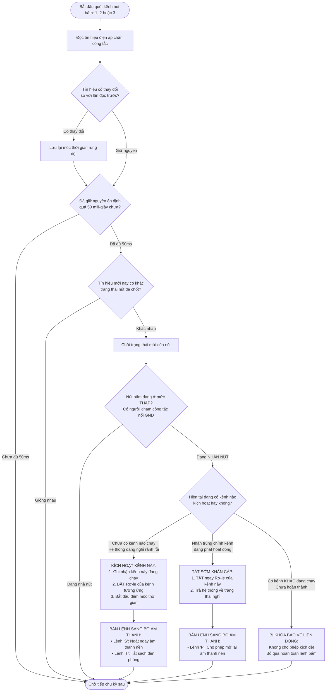
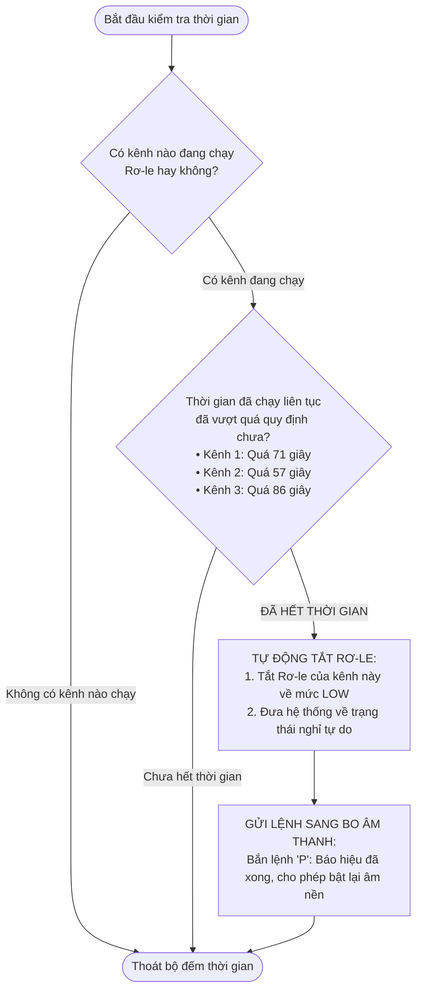
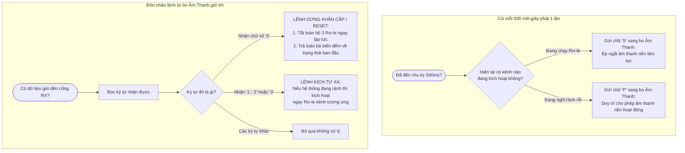

# LƯU ĐỒ THUẬT TOÁN (FLOWCHART) - VI ĐIỀU KHIỂN STM32_JUMPSCARE
*(Toàn bộ nội dung bằng Tiếng Việt 100%)*

---

## 1. SƠ ĐỒ KHỐI TỔNG QUAN HỆ THỐNG

```mermaid
graph TD
    A([BẮT ĐẦU CẤP ĐIỆN NGUỒN]) --> B[Khởi tạo cổng truyền thông UART 9600 baud:<br>Chân Nhận PB6 - Chân Truyền PB5]
    B --> C[Cấu hình 3 chân nút bấm: PA6, PA7, PB12<br>Chế độ kéo lên điện áp nguồn PULL-UP]
    C --> D[Cấu hình 3 chân Rơ-le: PA3, PA4, PB13<br>Ép TẮT TUYỆT ĐỐI mức LOW]
    D --> E[Gửi lệnh 'P' sang bo STM32_SOUND:<br>Báo trạng thái hệ thống đang RẢNH]
    E --> F[VÀO VÒNG LẶP CHÍNH LIÊN TỤC]
    
    F --> G[NHIỆM VỤ 1:<br>Quét 3 nút nhấn công tắc khô<br>Bộ lọc chống nhiễu, chống rung 50 mili-giây]
    F --> H[NHIỆM VỤ 2:<br>Bộ đếm thời gian tự động ngắt Rơ-le<br>Kênh 1: 71 giây | Kênh 2: 57 giây | Kênh 3: 86 giây]
    F --> I[NHIỆM VỤ 3:<br>Truyền nhận tín hiệu với bo Âm Thanh<br>Nhịp tim Heartbeat 500ms & Nhận lệnh từ xa]
    F --> J[NHIỆM VỤ 4:<br>Đèn xanh báo trạng thái PC13<br>Nháy nhanh 100ms khi chạy / Nháy chậm 500ms khi nghỉ]

    G --> F
    H --> F
    I --> F
    J --> F
```

---

## 2. LƯU ĐỒ QUÉT CÔNG TẮC & KHÓA CHỐNG KÍCH ĐÈ



---

## 3. LƯU ĐỒ TỰ ĐỘNG TẮT KHI HẾT THỜI GIAN CỦA TỪNG KÊNH



---

## 4. LƯU ĐỒ TRUYỀN THÔNG NỐI TIẾP VỚI BO ÂM THANH (UART)



---

## 5. BẢNG TỔNG HỢP CHI TIẾT CÁC KÊNH VÀ CHỨC NĂNG

| Tên Kênh | Chân Nút Nhấn (Nối Mass GND) | Chân Rơ-le (Kích Mức Cao 3.3V) | Thời Gian Chạy | Lệnh Gửi Sang Bo Âm Thanh | Ý Nghĩa Thực Tế Trong Phòng |
| :---: | :---: | :---: | :---: | :---: | :--- |
| **Kênh 1** | **PA6** | **PA3** | **71 giây** (1 phút 11 giây) | Gửi chữ **'S'** và **'T'** | Kích hoạt hiệu ứng hù ma đợt 1 |
| **Kênh 2** | **PA7** | **PA4** | **57 giây** | Gửi chữ **'S'** và **'T'** | Kích hoạt cửa sập / chuyển động đợt 2 |
| **Kênh 3** | **PB12** | **PB13** | **86 giây** (1 phút 26 giây) | Gửi chữ **'S'** và **'T'** | Kích hoạt màn hù dọa chính đợt 3 |
| **Cổng Nhận (RX)** | **PB6** | - | Tốc độ 9600 baud | Nhận **'0'**, **'1'**, **'2'**, **'3'** | Nối chéo từ chân PB10 của bo Âm Thanh |
| **Cổng Truyền (TX)** | **PB5** | - | Tốc độ 9600 baud | Truyền **'S'**, **'P'**, **'T'** | Nối chéo sang chân PB11 của bo Âm Thanh |
| **Đèn Báo PC13** | - | **PC13** | 100ms / 500ms | - | Nháy nhanh khi đang hù, nháy chậm khi nghỉ |
